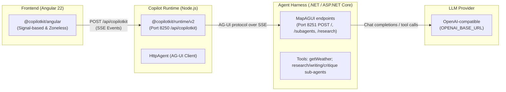

### Project Overview

This project is an **interactive test harness and demonstration suite** for validating the integration between **CopilotKit** (Angular client + Node runtime) and the **Microsoft Agent Harness** over the Microsoft Agent Framework (.NET / ASP.NET Core).

Its sibling, [`../ms-agent-dotnet`](../ms-agent-dotnet), covers the plain Agent Framework docs; this one covers the [ms-agent-harness-dotnet](https://docs.copilotkit.ai/angular/ms-agent-harness-dotnet) section.

It follows the structure of the Python harness, [`../ms-agent-py`](../ms-agent-py), and serves the same two purposes:

1. **Interactive Demo & QA Harness**: A running Angular 22 web application that implements each feature of `@copilotkit/angular` covered by the [ms-agent-harness-dotnet Angular docs](https://docs.copilotkit.ai/angular/ms-agent-harness-dotnet) against a live .NET Microsoft Agent Harness backend.
2. **Living Documentation Verifier**: Mirrors the official documentation in [doc-snapshot/](doc-snapshot), so the code snippets shown on each route are byte-identical to the code that runs.

---

### Architecture Overview



1. **Frontend (Browser - Angular 22)**: [app.config.ts](frontend/src/app/app.config.ts) uses `provideCopilotKit({ runtimeUrl: 'http://localhost:8250/api/copilotkit' })`. No model key reaches the browser.
2. **Copilot Runtime Proxy ([frontend/server.ts](frontend/server.ts))**: a standalone Node server on **port 8250** using `@copilotkit/runtime/v2`. Registers `default` and `support` (both → `http://localhost:8251/`), `subagents` (→ `/subagents`) and `research-agent` (→ `/research`) through `@ag-ui/client`'s `HttpAgent`, and enables `a2ui: {}`.
3. **Backend Agent ([backend/Program.cs](backend/Program.cs))**: ASP.NET Core on **port 8251**, `Microsoft.Agents.AI.Harness` + `Microsoft.Agents.AI.Hosting.AGUI.AspNetCore`. `POST /` is a `chatClient.AsHarnessAgent(...)` agent with a `getWeather` tool; `POST /subagents` is the showcase's sub-agents supervisor; `POST /research` is the AG-UI guide's `research-agent` (self-defined); `GET /health` is the liveness probe.

---

### Directory Structure

```
ms-agent-harness-dotnet-harness/
├── doc-snapshot/               # Versioned upstream documentation snapshots
│   ├── manifest.json           # SHA256 checksums & route mappings
│   ├── CHANGELOG.md            # Doc drift history
│   ├── reports/                # Timestamped diff analysis reports
│   └── pages/                  # Tracked official guide markdown files
├── backend/                    # .NET / Microsoft Agent Framework
│   ├── Backend.csproj          # Showcase harness package pins (net9.0, RollForward Major)
│   ├── Program.cs              # Self-defined host: default agent, MapAGUI endpoints
│   ├── ResearchAgent.cs        # Self-defined: the AG-UI guide's research-agent
│   ├── SubagentsAgent.cs       # Showcase, unchanged — what the Sub-Agents guide quotes
│   └── shared/                 # Showcase _shared/dotnet/LunaChatClientExtensions.cs, unchanged
├── autorecorder/               # Portable screen-recording suite (config/ + actions/ adapted)
└── frontend/                   # Angular 22 Application + Node Runtime
    ├── server.ts               # Copilot Runtime server (Node.js, Port 8250)
    ├── scripts/
    │   ├── generate-sources.ts # Syncs running source code into TypeScript strings
    │   └── doc-sync.ts         # Doc drift check / sync
    └── src/app/
        ├── app.config.ts       # Root providers (provideCopilotKit, sandbox functions)
        ├── app.routes.ts       # Doc routes + isolated chrome-free /demo routes
        ├── features/           # One folder per feature
        ├── lib/                # Nav configuration, source loader, doc-sync
        └── pages/              # Routed doc & overview pages
```

---

### Feature Modules & Implementation Status

Every route is defined once in [nav-config.ts](frontend/src/app/lib/nav-config.ts) and listed with its status on `/status`. **Unverified** means the route is implemented from the guide and the stack starts and streams, but the feature has not yet been exercised end to end against a live model.

| Doc page | Route(s) | Status |
| :--- | :--- | :--- |
| [Quickstart](https://docs.copilotkit.ai/angular/ms-agent-harness-dotnet/quickstart) | `/quickstart` | Unverified |
| [WebMCP](https://docs.copilotkit.ai/angular/ms-agent-harness-dotnet/webmcp) | `/webmcp` | Partial (Chrome 149+ / flag) |
| [Copilot Runtime](https://docs.copilotkit.ai/angular/ms-agent-harness-dotnet/copilot-runtime) | `/copilot-runtime` | Unverified |
| [AG-UI](https://docs.copilotkit.ai/angular/ms-agent-harness-dotnet/ag-ui) | `/ag-ui` | Unverified |
| [Sub-Agents](https://docs.copilotkit.ai/angular/ms-agent-harness-dotnet/multi-agent/subagents) | `/subagents` | Unverified |
| [Chat UI](https://docs.copilotkit.ai/angular/ms-agent-harness-dotnet/guides/chat-ui) | `/chat-ui` | Unverified |
| [Frontend tools & generative UI](https://docs.copilotkit.ai/angular/ms-agent-harness-dotnet/guides/frontend-tools-generative-ui) | `/frontend-tools-generative-ui` | Unverified |
| [A2UI](https://docs.copilotkit.ai/angular/ms-agent-harness-dotnet/guides/a2ui) | `/a2ui` | Unverified |
| [Voice & multimodal](https://docs.copilotkit.ai/angular/ms-agent-harness-dotnet/guides/voice-multimodal) | `/voice-multimodal` | Partial (no transcription service) |
| [Human-in-the-loop](https://docs.copilotkit.ai/angular/ms-agent-harness-dotnet/guides/human-in-the-loop) | `/human-in-the-loop` | Unverified |
| [Shared state](https://docs.copilotkit.ai/angular/ms-agent-harness-dotnet/guides/shared-state) | `/shared-state` | Unverified |
| [Threads, memory, attachments, headless](https://docs.copilotkit.ai/angular/ms-agent-harness-dotnet/guides/threads-memory-attachments-headless) | `/threads`, `/memory`, `/attachments`, `/headless` | Partial (threads/memory need Intelligence) / Unverified |

---

### Where the docs left gaps

Only the Sub-Agents page contains any C#; every other page is Angular/TypeScript and byte-identical to the ms-agent-dotnet and ms-agent-python pages. Gaps were filled from the CopilotKit showcase (`showcase/integrations/ms-agent-harness-dotnet/`), never invented, and each is labelled on its route:

- **Quickstart backend step** — published as `<!-- setup skipped: agent-setup is not bundled for ms-agent-harness-dotnet -->`. [backend/Program.cs](backend/Program.cs) is therefore self-defined, from the showcase's `Program.cs` building blocks.
- **Sub-Agents** — both C# snippets stop mid-`CreateAgent()`, call `AsLunaChatClient()` (never defined on the page), and take an `OpenAIClient` without saying where it comes from. The full showcase file and `LunaChatClientExtensions.cs` are copied unchanged; the client is built in `Program.cs` from `OPENAI_API_KEY` / optional `OPENAI_BASE_URL` (the showcase's `ApiKeyResolver` is left out, see [CLAUDE.md](CLAUDE.md)). The code hard-codes the model `gpt-6-luna` — kept as published.
- **AG-UI** — the guide addresses `research-agent` but never defines it; [backend/ResearchAgent.cs](backend/ResearchAgent.cs) is self-defined, as in the Python harness.
- **`getWeather`** — the tools guide renders a server tool it never shows; the .NET tool mirrors the Python harness's self-defined `getWeather(location)`.

---

### How to Run the Project

#### 1. Backend (.NET Agent Framework)

```bash
cd backend
cp .env.example .env    # set OPENAI_API_KEY (OPENAI_BASE_URL is optional)
dotnet run
# Runs on http://localhost:8251  (GET /health)
```

_Requires the .NET 9 SDK or newer (`RollForward` is `Major`, so a .NET 10-only machine works)._

#### 2. Copilot Runtime & Angular Frontend

```bash
cd frontend
npm install
# optional: echo "CPK_INTELLIGENCE_API_KEY=..." > .env   (threads / memory)

# Option A: Run runtime and frontend concurrently
npm run dev

# Option B: Run separately
npm run runtime    # Starts Copilot Runtime on http://localhost:8250
npm start          # Starts Angular Dev Server on http://localhost:4250
```

#### 3. Automated Screen Recording

Lives in [autorecorder/](autorecorder), adapted through `config/` and `actions/` only (see [autorecorder/README.md](autorecorder/README.md)). With the backend (`8251`), runtime (`8250`) and dev server (`4250`) running:

```bash
cd autorecorder
npm install
npx playwright install chromium
npm run doctor            # validate the configuration (exits 1 on error)
npm run record -- --list  # what will be recorded
npm run record            # record all pages
```

Recordings are saved to `autorecorder/videos/MSNET-HARNESS-angular-<NN>-<Name>.webm`.

#### 4. Documentation Drift & Sync

`/doc-sync` (and `npm run doc:check` / `npm run doc:sync` in `frontend/`) fetches the markdown behind every tracked page under `https://docs.copilotkit.ai/angular/ms-agent-harness-dotnet`, diffs it against `doc-snapshot/`, and ranks changes High (code fences), Medium (headings / nearby prose) or Low.

---

### Known doc findings

See [FINDINGS.md](FINDINGS.md).

### Upgrading Packages

Frontend: `npm --prefix frontend outdated`, then bump on a branch and `npm --prefix frontend run build`. Do not use `npm-check-updates -u` or `--legacy-peer-deps` (see the Python harness's README for why).

Backend: the `PackageReference` pins are the showcase's (`BeautifulChatAgent.csproj`) and are exact on purpose — they are what the Sub-Agents guide's `AgentSession` / `AgentResponse` / `RunCoreAsync` code was written against. If a newer `Microsoft.Agents.AI.*` release breaks the guide's code, that is a finding to record, not something to fix in the guide's file.
